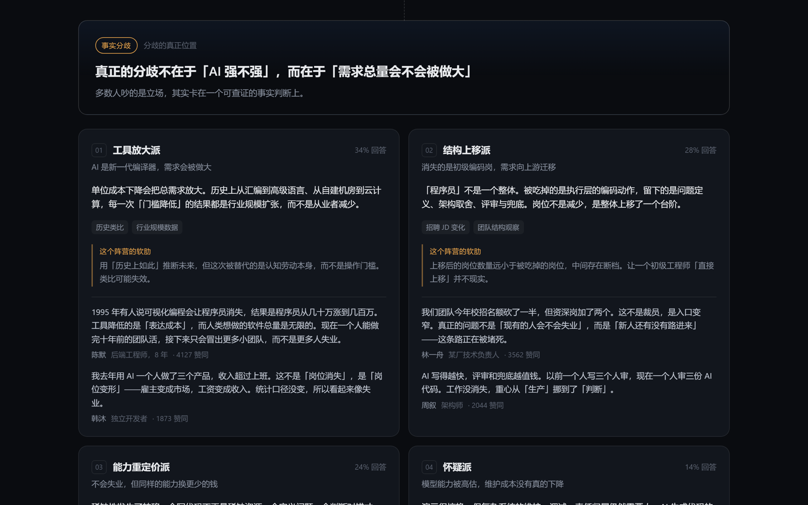

# Fork · 知乎问题的分歧地图

> 不是摘要，是结构。

**在线 Demo**：[fork-divergence-map.app.workbuddy.host](https://fork-divergence-map.app.workbuddy.host/?sharecode=G3YXORSPO5) —— 不用本地配置，打开即可体验四段分析与流式进度。



[30 秒演示视频](video/Fork演示视频.mp4)

## 一句话

把一个知乎问题下的高赞回答，拆成 3–4 个互斥的立场阵营，标出**分歧的真正位置**、**每个阵营的软肋**，以及哪些分歧可以靠证据裁决、哪些只能是价值取舍。

## 为什么值得做

现有的 AI 阅读工具都在做同一件事：把多种观点**抹平成一段共识**。"大家普遍认为……"——这句话恰恰消灭了知乎最有价值的东西。

知乎的产品基因不是「标准答案」，是**同一个问题下有人把相反的道理讲得都很有道理**。这种语料在中文互联网上是独一份的，通用大模型拿不到，竞品也复制不了。

所以 Fork 反过来做：不消除冲突，还原冲突。

## 三个不太一样的设计

**1. 事实分歧 vs 价值分歧**
每个分歧点都标注性质。可被数据裁决的是「事实分歧」，只能靠取舍的是「价值分歧」。混为一谈是网络上大部分争吵的根源——把它们分开，讨论才可能推进。

**2. 每个阵营都写「软肋」**
不只说他们主张什么，还说这个论证最容易被反驳的地方。这是为了让人形成判断，而不是选边站。

**3. 沉默的少数派**
赞同数不到最高赞 1%、但换了坐标系的回答。排序算法永远埋掉它们，但对"想清楚"的人来说恰恰最有用。

## 跑起来

```bash
cd fork-repo
npm start          # 无依赖，Node 20+ 直接运行
# 打开 http://localhost:4173
# 或带问题直接进入：/?q=AI%20编程工具会让程序员失业吗？
```

**当前状态**：仓库不含任何凭证。真实链路需要知乎开放平台凭证 + LLM 配置。装了 CLI 或注入了 Secret 但配置不完整时，页面徽章会显示「配置不完整」，分析会直接报错而不是悄悄回退；两者都没有时默认走示例数据。想强制演示示例数据，在 `.env` 里设 `FORK_DATA_SOURCE=sample`，页面会标注「示例数据集」。

内置两个示例问题（AI 编程工具、大城市选择），没有凭证也能完整体验四段分析和流式进度。示例模式只认这两个问题，输入其他问题会明确提示，不会静默复用第一条。

输入框只接受问题标题；知乎链接暂不能直接解析（开放平台没有问题详情接口），粘贴链接会明确提示改用标题。

随时运行 `node doctor.js` 检查配置状态，`node doctor.js --live` 实测数据链路。

## 测试

```bash
npm test    # 无凭证：强制示例数据，跑通 health / analyze / stream
```

CI 在 Node 20 上跑同一套冒烟测试，不需要任何密钥。

## 部署提示

- **限流**：默认每 IP 30 次/分钟、全站 120 次/分钟，可用 `RATE_LIMIT_PER_MIN` / `RATE_LIMIT_GLOBAL_PER_MIN` 调整。默认不信任代理头，避免客户端伪造 `X-Forwarded-For` 绕过限流；部署在反向代理后面时设 `TRUST_PROXY=1`，否则所有用户会共用代理 IP 的额度。
- **分享图**：`public/og.png` 是 1200×630 的社交分享图；`public/index.html` 里的 `og:url` / `og:image` 目前写的是公网 Demo 域名，换域名时同步替换。

## 接真实数据（三步）

数据层是 provider 模式：`retrieve → extract → cluster → classify`，最后 `result()` 返回 payload。

**第 1 步 · 写入 Access Secret**

到 https://developer.zhihu.com/profile 生成，然后在终端执行（Secret 不回显）：

```powershell
zhihu-cli auth set --secret-stdin
```

如果 `zhihu-cli` 不在 PATH，把 `.env` 里的 `ZHIHU_CLI_BIN` 指向它的绝对路径（`.env.example` 有示例）。

**第 2 步 · 填 LLM 配置**

把 `.env.example` 复制为 `.env`，填入 `LLM_BASE_URL` 和 `LLM_API_KEY`。任何 OpenAI 兼容端点都可以。`.env` 已加入 `.gitignore`，不会误提交。

**第 3 步 · 自检并启动**

```bash
node doctor.js --live    # 确认三项全绿
npm start                # 页面右上角变成绿色的「实时」
```

自动切换逻辑：检测到本机有 CLI，或环境变量里有 `ZHIHU_ACCESS_SECRET`，就走真实接口；这种情况下凭证或 LLM 缺失会明确报错，不会静默退回示例数据。两者都没有时默认用示例数据；想强制演示示例数据，设 `FORK_DATA_SOURCE=sample`。

真实链路：
1. 模型把问题改写成 6 个检索角度（第一个是原话），与原问题去重后最多 7 组 `search zhihu` 并发搜索
2. 按回答 ID 去重、按赞同数排序，最多取 24 条，连同系统提示词送进 LLM，一次产出阵营结构（`lib/providers/zhihu.js` 中的 `SYSTEM` 就是产品的核心资产）
3. 结构校验、引用锚定（模型改写的引用会被替换为原文片段）、按 share 归一化、按赞同排序引用
4. 经由 `/api/analyze/stream` 逐段推送进度，最后返回前端渲染

## 结构

```
fork-repo/
├── server.js                 零依赖 HTTP 服务：静态文件 + /api/analyze + /api/analyze/stream
├── doctor.js                 链路自检：检查 CLI / 凭证 / LLM，--live 会实测检索
├── .env.example              配置模板（复制为 .env 使用）
├── lib/config.js             .env 加载、CLI 探测、鉴权状态
├── lib/rate-limit.js         每 IP + 全站双阈值限流，默认不信任代理头
├── lib/pipeline.js           四段流水线，逐段上报开始/结束事件（前端进度条用真实事件）
├── lib/providers/index.js    provider 选择：有 CLI 就走真数据，可强制 sample
├── lib/providers/zhihu.js    知乎开放平台 + LLM 抽取（真实链路）
├── data/samples.json         示例数据集（同时是 payload 契约）
├── test/smoke.test.js        无凭证冒烟测试（示例数据）
├── docs/screenshot.png       README 截图
├── docs/og.html              OG 分享图源文件（截图生成 public/og.png）
├── .github/workflows/ci.yml  CI：Node 20 跑冒烟测试
├── LICENSE                   MIT
├── record-demo.js            用真实浏览器操作录制演示视频
├── video/                    演示视频成片与字幕源文件
└── public/                   单页前端，无构建（含 og.png 分享图）
```

## 30 秒路演脚本

> 同一个问题，一百个人在吵，但没人说得清他们到底在争什么。
> 这是「AI 会取代程序员吗」下的 1284 个回答。AI 摘要会告诉你"大家普遍认为需要关注"——等于没说。
> Fork 把它拆成四个阵营：**工具放大派、结构上移派、能力重定价派、怀疑派**。
> 更关键的是这一行：他们吵了两万条，真正的分歧不是"AI 强不强"，而是"需求总量会不会被做大"——**这是一个可以被数据裁决的事实问题，但所有人都在用价值观吵它**。
> 所以我们给每个阵营写了软肋，给每个分歧标了性质，还捞出那条只有 23 个赞、但换了个坐标系的回答。
> 知乎最值钱的不是共识，是分歧。我们把它做成了可以看的东西。

## 下一步（若继续）

- 多问题对比：同一议题在不同时间点的阵营变化（舆论漂移）
- 引用可溯源：点阵营直接跳回原文段落，支持反驳标注
- 用户投票自己的立场，看自己落在哪个阵营（社区互动，接活动广场）

## License

[MIT](LICENSE)
